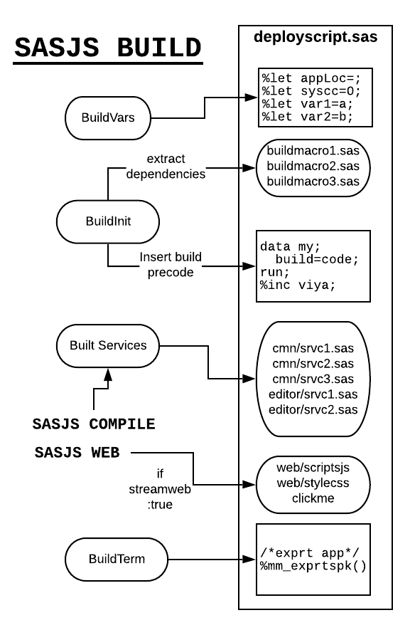

# sasjs build

For ease of project deployment, `sasjs build` brings all the compiled Jobs / Services / Tests together into a single file.  Actually, 3 files, as follows:

* `sasjsbuild/target.json` - used to deploy using the APIs in Viya or SASjs Server
* `sasjsbuild/target.json.zip` - used for faster uploads of large payloads in SASjs Server
* `sasjsbuild/target.sas` - used to create the project in SAS 9 or Viya (when no access token is available)

The filename corresponds to the target name unless [buildOutputFileName](https://cli.sasjs.io/sasjsconfig.html#buildConfig_buildOutputFileName) is specified.

## Syntax

```
sasjs build [options]
```

`sasjs build` takes one option:

| Option | Alias | Description |
| --- | --- | --- |
| `--target` | `-t` | The target whose configuration drives the build. Defaults to the `defaultTarget` in `sasjsconfig.json`. |

Examples:

```bash
sasjs build -t myTarget

# the same, using the alias
sasjs b -t myTarget
```

Nothing else is passed on the commandline: the artefact name, the folders and any streamed web content all come from the target's configuration - see [sasjsconfig](sasjsconfig.md). To run the compile step and the build step together, use [`sasjs cb`](cb.md); to add the deployment, [`sasjs cbd`](cbd.md).

`sasjs build` packages what is already in the build folder; it does not compile. If that folder is missing, the command stops and says so:

```
ERROR  An error has occurred when building services.
Run 'sasjs compile' (or 'sasjs cbd') first.
```

That keeps the build folder the input to the build step - which is what allows a compiled output to be adjusted by hand, or a single service to be compiled with [`sasjs compile service`](compile.md#compile-single-file) and then shipped. To compile and build in one step use [`sasjs cb`](cb.md), or [`sasjs cbd`](cbd.md) to add the deployment.


The benefit of having a seperate command to prepare the build artefacts (rather than bundling it into `sasjs compile`) is that you can then modify the compiled outputs to ensure you have the build you want - for example, removing tests for a production deploy.  If you don't need such changes, then you can just run `sasjs cb` as a shortcut for both `sasjs compile` and `sasjs build`.


## Target.JSON Build Artefact

The JSON file is used by the `sasjs deploy` command for the `SASVIYA` serverType to create all the necessary folders, jobs, services & tests (and streamed web apps) in the target `appLoc`.

## Target.json.ZIP Build Artefact

This is simply a zipped version of the target.json file, and is used when uploading apps or deploying projects to [SASjs Server](https://server.sasjs.io).

## Target.SAS Build Artefact

The generated SAS program can be executed directly in SAS 9 or SAS Viya to create all the jobs/services/tests programmatically. This is especially useful for Viya developers who are unable to obtain a client / secret. For SAS 9 it is the primary deployment method.

{ width="577" height="885" loading="lazy" decoding="async" }

### SAS 9 Build Script

The SAS 9 Build Program can be executed in EG or SAS Studio, and also automatically as part of `sasjs deploy` when `deployServicePack` is true.  You just need to have a runner in your metadata home directory, and to provide credentials using [sasjs auth](/auth).

### Viya Build Script

The .sas file can be executed in SASStudioV _without modification_ as proc http will use the `oauth_bearer=sas_services` option to authenticate to the APIs.  This is the way to deploy SASjs projects when you do not have a CLIENT or SECRET.

### Running Viya Build Script in Non-Viya-Enabled SAS sessions

If for some reason you need to run the _Viya_ build script in a _non_ SPRE / Viya-enabled session (eg in SAS 9 or SASjs Server) you will need to prepare the access token - see guidance here: [https://cli.sasjs.io/faq/#viya-token-macros](https://cli.sasjs.io/faq/#viya-token-macros)

Put this access token in a macro variable called `ACCESS_TOKEN` and it will be used by `proc http` in the [core](https://core.sasjs.io) macros by reference to the `access_token_var=` keyword parameter of each viya macro (the ones that start with `mv*`).

!!! Warning
    Saving security tokens in project repositories, especially if they are committed to source control, is a security risk - as anyone with access can use them to make modifications on the Viya platform. If you are running Viya code in non Viya-enabled SAS environments using the ACCESS_TOKEN approach described above, be sure to use a secure mechanism such as `%inc` from a secure directory, or another approved mechanism for securing these kinds of variables. Avoid writing Access Tokens to log files.

## Browser build (`streamConfig.mockWeb`)

Setting [`mockWeb`](https://cli.sasjs.io/sasjsconfig.html#streamConfig_mockWeb) to `true` makes `sasjs build` produce a second artefact: a self-contained static site whose backend runs in the browser. The same services run, the same `webout` and header contract applies, and there is no server, no SAS and no network in the path. It exists so an app whose services are JavaScript can be hosted on any static host - a demo, a review environment, a shared link - and still behave like a deployed SASjs app.

```json
"streamConfig": {
  "webSourcePath": "../client/dist",
  "mockWeb": true,
  "mockWebFolder": "sasjsbuild/mock"
}
```

`mockWeb` is independent of [`streamWeb`](https://cli.sasjs.io/sasjsconfig.html#streamConfig_streamWeb): the same target still deploys for real, so one config serves both the browser build and a normal `sasjs deploy`.

### Requirements

* the target's services must be JavaScript - typically the `mocks` project pattern, where `sas/mocks/sasjs/services` holds `.js` programs. A target that compiles `.sas` cannot be built for the browser, and the build says so
* [`webSourcePath`](https://cli.sasjs.io/sasjsconfig.html#streamConfig_webSourcePath) has to point at the built frontend (`dist` by default); the site is assembled from that folder
* the target's `appLoc` has to match the appLoc the frontend was built with, because the services are resolved from it

### What the build produces

The site is written to [`mockWebFolder`](https://cli.sasjs.io/sasjsconfig.html#streamConfig_mockWebFolder), `sasjsbuild/mock` by default. It contains the frontend, the compiled JavaScript services, a service worker and the small runtime that executes them. The virtual drive the services see is seeded from the build output - the same files `sasjs compile` wrote, plus anything `syncFolder` copied in - so a service reading `services/...` or a data file finds it without any upload step.

### How it runs

A service worker intercepts the calls the [SASjs Adapter](https://adapter.sasjs.io) makes, invokes the matching JavaScript service, and resolves `webout`, log and headers back to the app. Requests appear in the browser's network tab as they normally would. Anything the services write to the drive is kept in IndexedDB, so a page refresh does not lose it.

The site boots from `host/boot.js`: the build takes every script tag the page has, in document order, and the loader registers the worker, waits for it to control the page, and then replays those tags in the same order. Nothing about the app changes - same tags, same order, same globals - so a page that loads one bundled `main.<hash>.js` and a page that loads several plain scripts both work, and a bundler is not a requirement. Non-executable script blocks (`application/ld+json`, templates) are left alone.

The loader is a file rather than an inline script on purpose: an app that sets a strict Content-Security-Policy (`default-src 'self'`, no `unsafe-inline`) refuses an inline script, and the build cannot add a hash or nonce to a policy it does not own. A strict-CSP app therefore builds and runs unchanged.

### Downloads and file responses

A service answers with a file the same way it does on a server: it declares the response in `_SASJS_WEBOUT_HEADERS` and writes the body where the wrapper points it. The generated wrapper already declares `fs`, so a service uses it rather than requiring it again.

For text - a CSV, a DDL script, a log - assign `_webout` (or write the string to `weboutPath`):

```js
fs.writeFileSync(
  _SASJS_WEBOUT_HEADERS,
  'Content-type: text/csv\nContent-Disposition: attachment;filename="users.csv"'
)
_webout = 'id,name\n1,Ann\n'
```

For bytes - a zip, an xlsx, an image - write them to `weboutPath` as a `Buffer` or a `Uint8Array`:

```js
fs.writeFileSync(
  _SASJS_WEBOUT_HEADERS,
  'Content-type: application/zip\nContent-Disposition: attachment;filename="pack.zip"'
)
fs.writeFileSync(weboutPath, Buffer.from(zipBytes))
```

`Buffer.from()` takes bytes, an array of numbers, or a base64 string with `'base64'` as the second argument, so a library that produces base64 needs no extra step. This is the browser counterpart of `%mp_streamfile` - the same two writes - and the browser offers the response under the name in `Content-Disposition`.

Only `Content-type` and `Content-Disposition` are applied; any other header is ignored, because a static host has no cache to control and no cookies to set. A request made with `_debug` returns the text frame instead, since its body is the webout wrapped in the log.

Some things to keep in mind:

* the drive holds text, so a file a service writes as bytes is stored as base64 and reads back as bytes - it is a demo drive, not a filesystem for large binaries
* with no `Content-type` declared, a byte body is served as `application/octet-stream`
* a text response with no `Content-type` declared is served as `text/html; charset=utf-8`, the line a SASjs Server starts a session with - a service that answers with anything else should declare it, exactly as it has to on a server
* a filename outside ASCII belongs in RFC 6266 form - `Content-Disposition: attachment;filename*=UTF-8''r%C3%A9sum%C3%A9.csv`. Raw non-ASCII bytes in a header are not portable: the browser's own download honours the bytes it is given, and the same header sent by a SASjs Server arrives with node's latin1 encoding, so the two only agree on the ASCII form

### Writing to the drive

The drive endpoints answer the same contract a SASjs Server does, so a client that uploads, renames or deletes needs no change for a mock build - only the storage differs:

| Request | Effect |
| --- | --- |
| `POST /SASjsApi/drive/file?_filePath=/data/up.csv` | create a file, from a multipart body with the field `file` (`filePath` may be sent as a form field instead of the query) |
| `PATCH /SASjsApi/drive/file?_filePath=/data/up.csv` | replace a file that exists |
| `DELETE /SASjsApi/drive/file?_filePath=/data/up.csv` | delete a file |
| `POST /SASjsApi/drive/folder` | create a folder, from a JSON body `{ "folderPath": "/data/reports" }` |
| `DELETE /SASjsApi/drive/folder?_folderPath=/data/reports` | delete a folder and everything under it |
| `POST /SASjsApi/drive/rename` | move a file or folder, from a JSON body `{ "oldPath": "...", "newPath": "..." }` |

A successful write answers `{"status":"success"}`, a create over a file that already exists answers `409`, and replacing or deleting a file that is not there answers `404` - the statuses the server's routes use. Paths are drive-relative: a leading slash means "under the drive root", never the host's filesystem, and a path that climbs out with `..` is refused with a `400`. A file whose extension is `.exe`, `.sh` or `.htaccess` is refused on every route that creates, replaces, deletes or renames it, as it is on a server.

What a visitor writes stays in that visitor's drive: it is kept in IndexedDB in their own browser, so it survives a refresh but is not shared with anyone else, and an empty folder is not kept across a reload because the drive is stored as a map of files. Preloaded data is still shipped as a snapshot, below.

### Serving it

Serve the folder over http or https. A service worker needs a secure context, which means `localhost` and `https` both work but `file://` does not:

```bash
cd sasjsbuild/mock
python3 -m http.server 8099
```

Deploy it like any static site - it is just files. The runtime files under `host/` are referenced with a `?v=<hash>` query that changes with their contents, so a redeploy replaces them for returning visitors too; upload `index.html` and `sw.js` together with everything else, since those two carry the reference.

### Trying the API (`/api`)

Every browser build ships an API console at `<base>/api/`. It lists the operations the host answers, renders a form for each from the parameters the API declares, and sends the request the way an application does - same origin, same service worker, so the answer is the mock's real answer. It is generated at build time from the same route table the worker dispatches, so a route the package adds appears on the next build.

Type the URL rather than looking for a link: the console is a developer surface, nothing in the application points at it, and nothing preloads it.

* writes are allowed on purpose. A demo exists to be played with, and everything is recoverable: add `?reset=1` to the console's URL and it clears the stored drive and seeds it again from the shipped state. A browser's hard refresh does **not** do that - it only bypasses the HTTP cache.
* the demo accounts are printed on the page, with the password, because a browser build has no login wall to protect and a visitor needs to know what to type after logging out. **Act as** restarts the page as that account and sends every call after it with that account's token, so a refusal a restricted user gets is the refusal an application gets.
* uploads are not sent by the console. A route whose body is `multipart/form-data` (a file upload, a deployment archive) is listed, and the page says to use the application or a client of your own.

Turn it off with `mockApi: false` in the target's `streamConfig`, for a site whose output must be the application and nothing else:

```json
{
  "targets": [
    {
      "name": "mock",
      "appLoc": "/Public/app/demo",
      "streamConfig": { "mockWeb": true, "webSourcePath": "build", "mockApi": false }
    }
  ]
}
```

### Shipping the site with data

Out of the box the drive a visitor gets holds the services and whatever else lives in the build folder - enough to run, but empty of the data those services would have produced. A snapshot changes that: if `mock-snapshot.json` sits in the build folder, the build ships it with the site and the runtime prefers it over the plain seed, so every visitor starts from the captured state instead of an empty drive.

To capture one, open the site, use the app until the drive is in the state you want, and run this in the browser console:

```js
await window.SASjsMock.download()
```

That saves `mock-snapshot.json` to your downloads. Put it beside the compiled output - `sasjsbuild/mock-snapshot.json` for the default build folder - and build again. The build reports it in `host/mock-config.json` as `"snapshot": true`, with the number of pieces it was split into.

```json
{
  "appLoc": "/Public/app/dc",
  "snapshot": true,
  "snapshotShards": 6,
  "driveEntries": 97,
  "jsPrograms": 43
}
```

#### How the snapshot is shipped

A real app's drive runs to megabytes, and a visitor's first page does not read most of it: a list of apps reads a config and a few logos, not the bundles behind them. So the build splits the capture into pieces:

* `host/vfs-snapshot-0.json` is the **boot shard**: the files under 256KB whose folder comes to less than 64KB - a listing, the configuration, an app's logo. It is fetched with the page.
* a file of 256KB or more gets a shard of its own, and a folder whose files come to more than 64KB gets one shard. These are fetched when something reads a path in them: a drive route, an app being opened, a service reading a file at run time.
* `host/vfs-snapshot.json` is the **index**: every path with its piece and size. A listing, a size or an existence check is answered from it without fetching anything.

Nothing in a project changes: `mock-snapshot.json` is still one plain JSON map of drive path to file contents, and an existing snapshot builds as before. Upload the whole `host/` folder - the index names its pieces by relative path.

Three things worth knowing:

* the snapshot is a plain JSON map of drive path to file contents, and a real app's drive runs to megabytes, so treat it as a build input you generate rather than something to keep in git
* state stays tied to where it was captured. A licence issued for one origin does not decrypt on another, so capture the snapshot on the domain you deploy to - if an app asks to be licensed or configured after deployment while it worked locally, this is the usual reason
* to start over, `window.SASjsMock.reset()` clears the persisted drive and reseeds from the shipped files; to ship the plain seed instead, remove `mock-snapshot.json` from the build folder and build again

!!! warning
    This is a single-user, no-authentication build. Services that read SAS tables, run macros or depend on SAS libraries cannot work in it, because there is no SAS engine in the browser. Treat it as a demo and review artefact, not as a replacement for a real deployment.
