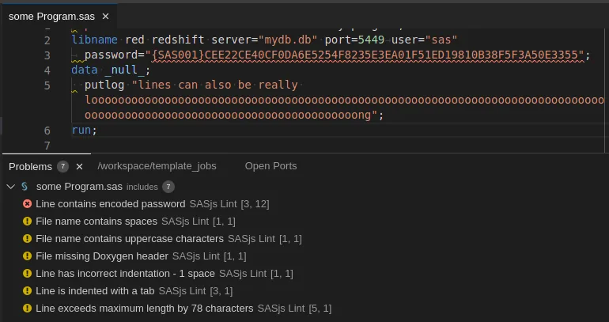

# sasjs lint

The `sasjs lint` command is used to identify issues such as embedded passwords, trailing spaces, sloppy indentation, missing program headers and more, in your SAS code.

This means developers can spend less time on code reviews and formatting fixes, as well as preventing dangerous code, or code with hard-to-detect bugs from hitting production servers.

`lint` reads your source. For what SAS printed when the code actually ran - `ERROR`s, `WARNING`s and the notes that flag a problem - see [sasjs logcheck](/logcheck), which is the post-execution counterpart.


## Prerequisites

Before using this command, you simply need to [install](/installation) the SASjs CLI.  It is NOT necessary to configure a `sasjs/sasjsconfig.json` file - the `sasjs lint` command can be executed from anywhere - including from within a git hook.

## Configuration

The [lint settings](https://github.com/sasjs/lint/blob/main/README.md) are described in the lint README.  The settings can be made in a project directory (`/your/project/.sasjslint`), with a fallback settings file in the home directory (`~/.sasjslint`).  If a setting is not defined in either the project or the home directory, then the default value is used.

Linting is applied to all .sas files in all subfolders within the Project Directory.  The rule for determining the Project Directory is as follows:

* If the current directory contains a .sasjslint file, then use the current directory
* Else search all parent directories for a .sasjslint file (ignoring the home directory) and if found, use that
* If no .sasjslint file is contained in any parent directories, then use the current directory

For clarity, the Project Directory is printed to the console whenever running `sasjs lint`.

### Editor support

Every setting, its type and its default are described by the lint schema: [sasjslint-schema.json](https://cli.sasjs.io/sasjslint-schema.json).

Adding `$schema` at the top of the file lets an editor that understands JSON schemas complete and check the settings as you type, and shows each rule's description on hover:

```json
{
  "$schema": "https://cli.sasjs.io/sasjslint-schema.json",
  "noTrailingSpaces": true
}
```

The file is read as strict JSON, so it cannot carry comments - `$schema` is how the settings are documented where they are written. A file that fails to parse is an error for `sasjs lint`, so keep the additions inside the object.

## Syntax

```
sasjs lint [find | fix | init] [filterStrings..]
```

| Action | What it does |
| --- | --- |
| `find` | Reports violations. This is what runs when no action is given. |
| `fix` | Applies the fixes the configured rules provide. |
| `init` | Writes a `.sasjslint` configuration file for the project. |

Each `filterStrings` narrows the run: a folder, an absolute file path, or a fragment of a file name. With none, every `.sas` file in the project is linted.

## sasjs lint

### Syntax

The command works as follows:

```bash
sasjs lint
```

### Usage

Simply run the command and the list of exceptions (along with line / column numbers) is shown in the console, eg:

{ width="770" height="407" loading="lazy" decoding="async" }

## Failing on warnings

By default an `ERROR` fails the run (exit code 3) and a `WARNING` does not - it is reported, and the command still succeeds. Two ways to make a warning fail instead.

For a single run, set the lowest severity that fails:

```bash
sasjs lint --fail-on warning
```

`--fail-on` takes `error` (the default) or `warning`. The exit code stays `3`, so a pipeline still tells a lint failure from an internal error, and the `sasjs lint fix` action is unaffected.

For the project, so that every run - including the one the VS Code extension makes - treats warnings the same way, set a default in `.sasjslint`:

```json
{
  "severityLevel": { "default": "error" }
}
```

`default` applies to every rule that has no entry of its own, including the rules added in later versions, so a new rule needs no `.sasjslint` change to be treated like the rest. A rule named in the same object still wins:

```json
{
  "severityLevel": {
    "default": "error",
    "maxLineLength": "warn"
  }
}
```

Precedence is the rule's own entry, then `default`, then the severity built into the rule. The setting needs `@sasjs/lint` 5.1.0 or later, which ships with `@sasjs/cli` 6.21.0 - an earlier version ignores it silently, which reads as the setting having no effect.

The two are independent: `--fail-on` changes the verdict of one run without touching the configuration, and `severityLevel.default` changes what is reported, so it also changes how the editor colours the violations.

## sasjs lint fix

### Syntax

The command works as follows:

```bash
sasjs lint fix
```

### Usage

Running the command applies the fixes. The following rules support `autofix`:

* noTrailingSpaces
* hasDoxygenHeader
* hasMacroNameInMend
* lowerCaseFileNames

## Usage in a GIT hook

The `sasjs lint` command will return a non-zero exit code if any exceptions are found.  A great way to prevent questionable code from ever hitting your GIT repo (let alone the production server) is to run the linter as part of a pre-commit hook.

To configure this, there are two steps.  First, add the following to the "scripts" section of your `package.json` file: `"prepare": "git rev-parse --git-dir && git config core.hooksPath ./.git-hooks || true"`

Then, add the following to your `.git-hooks/pre-commit` file (see [example](https://github.com/sasjs/core/blob/main/.git-hooks/pre-commit)):

```
#!/bin/bash

# Ensure lint is passing
LINT=`sasjs lint`
if [[ "$LINT" != "✔ All matched files use @sasjs/lint code style!" ]]; then
  echo "$LINT"
  echo "To commit in spite of these warnings, use the -n parameter."
  exit 1
fi
```

If you run `sasjs create SOMEPROJECT -t jobs` you can check out a sample project with this hook already configured.  Or, you can just [clone this repo](https://github.com/sasjs/template_jobs) and run `npm prepare`.

## Further Resources:

* [Using the linter on terminal](https://vid.4gl.io/w/vmJspCjcBoc5QtzwZkZRvi)
* [Longer intro to sasjs lint](https://vid.4gl.io/w/nDtkQFV1E8rtaa2BuM6U5s)
* Source repo:  [https://github.com/sasjs/lint](https://github.com/sasjs/lint)
* SAS blog post: [https://blogs.sas.com/content/subconsciousmusings/2025/05/30/automatic-linting-of-sas-code-with-sasjs/](https://blogs.sas.com/content/subconsciousmusings/2025/05/30/automatic-linting-of-sas-code-with-sasjs/)


## Sponsorship & Contributions

SASjs is an open source framework, and contributions are welcome. If a rule or feature would help your project and you do not have the TypeScript experience to build it, [get in touch](https://sasapps.io/contact-us) about building it with us.

<!-- cli-docs-ignore: --git-dir (git rev-parse flag in the hooks example) -->
