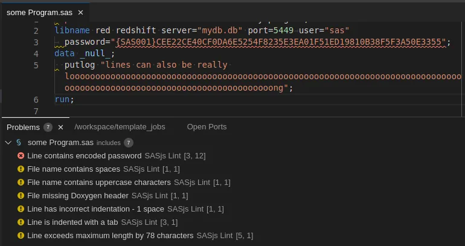

# sasjs lint

The `sasjs lint` command is used to identify issues such as embedded passwords, trailing spaces, sloppy indentation, missing program headers and more, in your SAS code.

This means developers can spend less time on code reviews and formatting fixes, as well as preventing dangerous code, or code with hard-to-detect bugs from hitting production servers.


## Prerequisites

Before using this command, you simply need to [install](/installation) the SASjs CLI.  It is NOT necessary to configure a `sasjs/sasjsconfig.json` file - the `sasjs lint` command can be executed from anywhere - including from within a git hook.

## Configuration

The [lint settings](https://github.com/sasjs/lint/blob/main/README.md) are described in the lint README.  The settings can be made in a project directory (`/your/project/.sasjslint`), with a fallback settings file in the home directory (`~/.sasjslint`).  If a setting is not defined in either the project or the home directory, then the default value is used.

Linting is applied to all .sas files in all subfolders within the Project Directory.  The rule for determining the Project Directory is as follows:

* If the current directory contains a .sasjslint file, then use the current directory
* Else search all parent directories for a .sasjslint file (ignoring the home directory) and if found, use that
* If no .sasjslint file is contained in any parent directories, then use the current directory

For clarity, the Project Directory is printed to the console whenever running `sasjs lint`.

## Syntax

```
sasjs lint [find | fix | init] [filterStrings..]
```

| Action | What it does |
| --- | --- |
| `find` | Reports violations. This is what runs when no action is given. |
| `fix` | Applies the fixes the configured rules provide. |
| `init` | Writes a `.sasjslint` configuration file for the project. |

Each `filterStrings` narrows the run: a folder, an absolute file path, or a fragment of a file name. With none, every `.sas` file in the project is linted.

## sasjs lint

### Syntax

The command works as follows:

```bash
sasjs lint
```

### Usage

Simply run the command and the list of exceptions (along with line / column numbers) is shown in the console, eg:

{ width="770" height="407" loading="lazy" decoding="async" }

## sasjs lint fix

### Syntax

The command works as follows:

```bash
sasjs lint fix
```

### Usage

Running the command applies the fixes. The following rules support `autofix`:

* noTrailingSpaces
* hasDoxygenHeader
* hasMacroNameInMend
* lowerCaseFileNames

## Usage in a GIT hook

The `sasjs lint` command will return a non-zero exit code if any exceptions are found.  A great way to prevent questionable code from ever hitting your GIT repo (let alone the production server) is to run the linter as part of a pre-commit hook.

To configure this, there are two steps.  First, add the following to the "scripts" section of your `package.json` file: `"prepare": "git rev-parse --git-dir && git config core.hooksPath ./.git-hooks || true"`

Then, add the following to your `.git-hooks/pre-commit` file (see [example](https://github.com/sasjs/core/blob/main/.git-hooks/pre-commit)):

```
#!/bin/bash

# Ensure lint is passing
LINT=`sasjs lint`
if [[ "$LINT" != "✔ All matched files use @sasjs/lint code style!" ]]; then
  echo "$LINT"
  echo "To commit in spite of these warnings, use the -n parameter."
  exit 1
fi
```

If you run `sasjs create SOMEPROJECT -t jobs` you can check out a sample project with this hook already configured.  Or, you can just [clone this repo](https://github.com/sasjs/template_jobs) and run `npm prepare`.

## Further Resources:

* [Using the linter on terminal](https://vid.4gl.io/w/vmJspCjcBoc5QtzwZkZRvi)
* [Longer intro to sasjs lint](https://vid.4gl.io/w/nDtkQFV1E8rtaa2BuM6U5s)
* Source repo:  [https://github.com/sasjs/lint](https://github.com/sasjs/lint)
* SAS blog post: [https://blogs.sas.com/content/subconsciousmusings/2025/05/30/automatic-linting-of-sas-code-with-sasjs/](https://blogs.sas.com/content/subconsciousmusings/2025/05/30/automatic-linting-of-sas-code-with-sasjs/)


## Sponsorship & Contributions

SASjs is an open source framework, and contributions are welcome. If a rule or feature would help your project and you do not have the TypeScript experience to build it, [get in touch](https://sasapps.io/contact-us) about building it with us.

<!-- cli-docs-ignore: --git-dir (git rev-parse flag in the hooks example) -->
